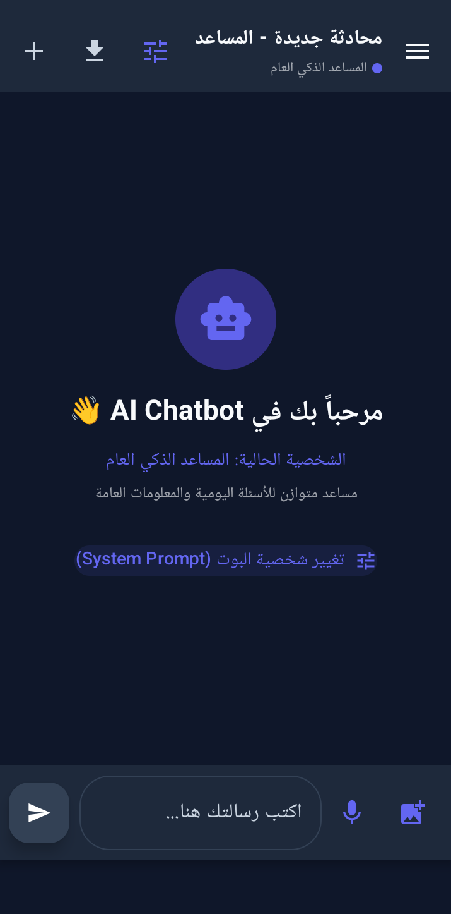

<div align="center">


# 🤖 AI-Chatbot

### مساعدك الذكي على أندرويد — محادثات أذكى لحياة أسهل

تطبيق أندرويد أصلي مبني بـ **Kotlin** و **Jetpack Compose**، يعمل بنموذج **Google Gemini** مع ردود فورية متدفقة، وتحليل الصور، والإدخال الصوتي، وتصدير المحادثات.


<br/>

[📥 **تحميل التطبيق**](https://github.com/hassan3alabadi305-alt/AI-Chatbot/raw/main/AI-Chatbot.apk)

<a href="#overview">📖 نظرة عامة</a> •
<a href="#features">✨ المميزات</a> •
<a href="#screenshots">📸 الصور</a> •
<a href="#download">📥 التحميل</a> •
<a href="#demo">🎬 الفيديو</a> •
<a href="#tech">🛠 التقنيات</a> •
<a href="#setup">🚀 التشغيل</a>

</div>

---

<div dir="rtl">

<a id="overview"></a>

## 📖 نظرة عامة

**AI-Chatbot** هو مساعد ذكي يعمل على هاتفك: تسأله فيجيبك بدقة وسرعة، ويكتب لك النصوص، ويولّد الأفكار، ويساعدك في حل المشكلات، ويحلل الصور التي ترسلها له.

التطبيق مبني بالكامل بـ **Kotlin** و **Jetpack Compose** بمعمارية **MVVM**، مع قاعدة بيانات **Room** لحفظ سجل المحادثات على الجهاز، وواجهة عربية تدعم الاتجاه من اليمين لليسار.

> 💡 لو لم تضف مفتاح Gemini، يعمل التطبيق تلقائياً بوضع تجريبي (Demo) بردود محاكاة، فتقدر تجرب الواجهة كاملة بدون أي إعداد.

---

<a id="features"></a>

## ✨ المميزات

| | الميزة | الوصف |
|---|---|---|
| 💬 | **ردود متدفقة** | تظهر إجابة الذكاء الاصطناعي كلمة بكلمة بشكل فوري وطبيعي |
| 🖼️ | **تحليل الصور** | أرفق صورة من الكاميرا أو المعرض ليحللها النموذج |
| 🎙️ | **إدخال صوتي** | اكتب رسائلك بصوتك عبر التعرف على الكلام في أندرويد |
| 🎭 | **شخصيات متعددة** | 5 شخصيات: المساعد العام، خبير البرمجة، الكاتب المبدع، معلم اللغات، المحلل المنطقي |
| 🗂️ | **جلسات متعددة** | أنشئ محادثات كثيرة وتنقل بينها، وكلها محفوظة محلياً |
| 📄 | **تصدير المحادثات** | احفظ أي محادثة بصيغة **PDF** أو ملف نصي |
| ✍️ | **Markdown والأكواد** | تنسيق النصوص وإبراز الأكواد داخل فقاعات المحادثة |
| 🌗 | **فاتح / داكن** | ثيم Material 3 كامل |
| 🌐 | **دعم العربية** | واجهة تدعم RTL، وتعدد اللغات في المحادثة |

---

<a id="screenshots"></a>

## 📸 لقطات الشاشة

</div>

<div align="center">



<sub>شاشة المحادثة</sub>

</div>

<div dir="rtl">

---

<a id="download"></a>

## 📥 تحميل التطبيق

</div>

<div align="center">

### [⬇️ تحميل AI-Chatbot.apk](https://github.com/hassan3alabadi305-alt/AI-Chatbot/raw/main/AI-Chatbot.apk)

</div>

<div dir="rtl">

**خطوات التثبيت:**

1. اضغط زر التحميل أعلاه من هاتف أندرويد.
2. افتح الملف بعد انتهاء التحميل.
3. لو ظهرت رسالة أمان، فعّل **السماح بالتثبيت من هذا المصدر**.
4. اضغط **تثبيت**، وابدأ المحادثة.

> يتطلب أندرويد 7.0 (API 24) أو أحدث.

---

<a id="demo"></a>

## 🎬 فيديو العرض

</div>

<div align="center">

[▶️ **شاهد عرض التطبيق على يوتيوب**](https://youtube.com/shorts/d_4O4fLb05k?feature=share)

</div>

<div dir="rtl">

---

<a id="tech"></a>

## 🛠 التقنيات المستخدمة

| الطبقة | التقنية |
|---|---|
| اللغة | Kotlin |
| الواجهة | Jetpack Compose + Material 3 |
| المعمارية | MVVM (ViewModel + Repository) |
| التخزين المحلي | Room (KSP) |
| الشبكة | OkHttp, Retrofit, Moshi |
| التزامن | Kotlin Coroutines & Flow |
| الصور | Coil |
| الذكاء الاصطناعي | Google Gemini API (`gemini-3.5-flash`، بث مباشر + صور) |
| الأمان | Firebase App Check (reCAPTCHA) |
| الاختبارات | JUnit, Espresso, Robolectric, Roborazzi |

---

## 📂 هيكل المشروع

</div>

```
app/src/main/java/com/example/
├── data/
│   ├── local/          # Room: الجلسات والرسائل
│   ├── remote/         # GeminiApiClient: الاتصال بالـ API
│   ├── repository/     # ChatRepository
│   └── model/          # Persona (الشخصيات)
├── ui/
│   ├── components/     # الفقاعات، اختيار الشخصية، القائمة الجانبية، التصدير
│   ├── theme/          # الألوان والخطوط والثيم
│   ├── ChatScreen.kt
│   └── ChatViewModel.kt
├── util/               # Markdown، تصدير PDF، الملفات
└── MainActivity.kt
```

<div dir="rtl">

---

<a id="setup"></a>

## 🚀 التشغيل من الكود المصدري

**المتطلبات:** [Android Studio](https://developer.android.com/studio) (أحدث إصدار مستقر)، ومفتاح [Gemini API](https://ai.google.dev/) (اختياري).

1. **انسخ المشروع:**
   ```bash
   git clone https://github.com/hassan3alabadi305-alt/AI-Chatbot.git
   ```
2. افتحه في **Android Studio** وانتظر مزامنة Gradle.
3. **أضف المفتاح:** انسخ `.env.example` باسم `.env` وضع مفتاحك:
   ```
   GEMINI_API_KEY=your_api_key_here
   ```
4. شغّل التطبيق على محاكي أو هاتف حقيقي.

> ⚠️ لا ترفع ملف `.env` أو أي مفتاح حقيقي على GitHub. الملف مستثنى في `.gitignore`.

---

## 🎯 خارطة الطريق

- [ ] مزامنة المحادثات سحابياً
- [ ] دعم لغات أكثر للإدخال الصوتي
- [ ] ويدجت للشاشة الرئيسية
- [ ] نسخة Wear OS

---

## 🤝 المساهمة

المساهمات مرحب بها:

1. اعمل **Fork** للمشروع
2. أنشئ فرعاً جديداً: `git checkout -b feature/my-feature`
3. سجّل تعديلاتك ثم افتح **Pull Request**

---

## 📄 الترخيص

المشروع مرخّص تحت **MIT License**. التفاصيل في ملف [LICENSE](LICENSE).

</div>

<details>
<summary><b>🇬🇧 English summary</b></summary>

<br/>

**AI-Chatbot** is a native Android AI assistant built with Kotlin and Jetpack Compose, powered by the Google Gemini API (`gemini-3.5-flash`). It features streamed responses, image and voice input, 5 switchable personas, multi-session chat history stored with Room, PDF/text export, Markdown & code rendering, light/dark themes, and an RTL-ready Arabic UI. Without an API key it runs in a built-in demo mode.

**Download:** [AI-Chatbot.apk](https://github.com/hassan3alabadi305-alt/AI-Chatbot/raw/main/AI-Chatbot.apk) · **Demo:** [YouTube](https://youtube.com/shorts/d_4O4fLb05k?feature=share)

</details>

---

<div align="center">


**Hassan Al-Abadi**

Developer • Creator • Problem Solver

[](https://github.com/hassan3alabadi305-alt)

⭐ لو أعجبك المشروع، لا تنسَ تعمل Star للريبو

</div>
